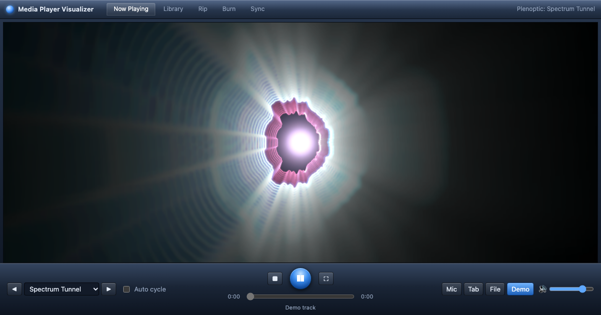

# Media Player Visualizer

Music visualizations in the spirit of the classic Windows Media Player "Now Playing" screen, running in the browser. They react to whatever audio you point them at: the microphone, a shared browser tab or screen, a local audio file, or a built-in demo loop.

Live: **https://wmp.stamko.info** · TV apps for Android TV, LG and Samsung on the [Releases](../../releases) page.



## Visualizations

Grouped by the collection names Windows Media Player used, plus three modern ones.

| Collection | Name | Look |
| --- | --- | --- |
| Bars and Waves | Bars | Gradient spectrum bars with white peak caps that hang, then fall |
| Bars and Waves | Scope | A triggered oscilloscope line whose colour drifts |
| Bars and Waves | Ocean Mist | A blue waveform whose trace rises and blurs into mist |
| Bars and Waves | Fire Storm | A wall of flames fed by the spectrum (bass in the middle), flickering upward, with embers thrown on beats |
| Ambience | Swirl | Waveform loops smeared into slowly turning smoke |
| Battery | Kaleidovision | A mirrored waveform star feeding an outward kaleidoscope tunnel |
| Alchemy | Random | Sparks flung from the centre, mirrored into a kaleidoscope |
| Plenoptic | Spectrum Tunnel | Spectrum-shaped rings rushing towards you |
| Musical Colors | Color Wheel | Six wedges of colour, each lit by one slice of the spectrum |
| Modern | Neon Terrain | Synthwave landscape built from the spectrum history, with a sun on the horizon |
| Modern | Radial Pulse | Mirrored circular spectrum with a breathing core |
| Modern | Particle Flow | Particles drifting through a morphing flow field, pushed out on beats |
| Screensavers | DVD Bounce | The bouncing DVD logo: new colour on each wall, swells on the beat, confetti on a perfect corner hit |
| Screensavers | Starfield | Flying through stars; loudness is warp speed, beats tint them |
| Screensavers | Mystify | Two bouncing polygons with echo trails |
| Screensavers | 3D Pipes | Shiny pipes growing smoothly through a 3D grid with depth shading; a little faster with louder music, fades out and restarts when full |
| Screensavers | Digital Rain | Green glyph rain; columns follow the spectrum and flare on beats |
| Screensavers | Bezier | Bouncing Bezier curves with echo trails |
| Screensavers | 3D Text | Extruded spinning text that bounces on the beat; type your own text in the box |
| Screensavers | 3D Maze | First-person brick maze walk, one step per beat |
| Screensavers | Flying Toasters | Winged toasters and toast; wings flap on the beat |
| Screensavers | Bliss | A drawn green hill and blue sky; grass sways on the beat |
| Screensavers | Blue Screen | A classic blue screen that glitches on beats and "crashes" on drops |
| Spikes | Spike | Circle of spectrum spikes with afterglow |
| Retro Players | Classic Spectrum / Classic Oscilloscope | Chunky segmented spectrum bars and pixel scope from the late-90s players |
| Retro Players | Light Ribbons | Glowing twisting light ribbons |
| Milkdrop | Milkdrop Presets | 100 classic Milkdrop presets via Butterchurn (WebGL); a new one every 20 s on a beat, N skips |
| Memes | Rainbow Cat, Party Parrot, Dancing Baby, Vibing Cat, Doge | Original cartoon tributes that dance on the detected beat |

All motion is time-based, so it runs at the same speed on 60, 120 or 144 Hz screens and stays smooth when a frame is dropped.

Switch with the dropdown, the arrow buttons, or the Left / Right keys. "Random" (or the R key) picks a random visualization about every 20 seconds (a random 14 to 28 s each time, then it waits for the start of a 4-bar phrase, or switches early on a drop), plus on each new track. It shuffles: every visualization plays once before any repeats. The address bar always holds `?viz=<id>` (and `&text=` for 3D Text), so links are shareable.

**2000s look** (on by default, T or the checkbox): object-style graphics (the picture screensavers such as DVD, Pipes, Maze, Flying Toasters, Bliss, Marquee, plus the memes) are drawn at about 640 px wide with light dithering, smoothly upscaled, and given a faint glow and scanlines. Classic visualizations stay sharp. Mark a class with `static retro = true` to opt in. On every beat the whole picture also brightens and punches in slightly (the beat pump in `js/main.js`), so all visualizations visibly move in time.

Random uses a shuffled playlist: each visualization plays once per round, and two from the same collection never play back to back. With Random on, Next / Previous also pick at random.

A tempo tracker in `js/audio.js` estimates BPM and runs a beat clock (`frame.phase`, `frame.beatCount`) locked to the detected beats; dancing characters and stepping animations use it so they stay on the beat.

Milkdrop uses [Butterchurn](https://github.com/jberg/butterchurn) (MIT), self-hosted in `vendor/butterchurn/` and loaded only when selected.

## Audio sources

- **Microphone.** Uses `getUserMedia` with echo cancellation, noise suppression and auto gain turned off, so music is not mangled. When more than one input exists, a device dropdown appears in the control bar. This is also how to visualize **everything the computer plays** on macOS: install a loopback driver such as [BlackHole](https://existential.audio/blackhole/), set up a Multi-Output Device in Audio MIDI Setup so you still hear the sound, and pick BlackHole as the input here.
- **Tab / screen audio.** Uses `getDisplayMedia`. In Chrome or Edge, pick a tab (or, on Windows, a screen) and tick **Share audio** in the picker. The video track is dropped immediately; only the audio is used. Safari and Firefox do not offer audio with screen sharing.
- **Audio file.** Open a file or drop one anywhere on the window. The transport bar (play / pause, seek, volume) applies to this source.
- **Demo track.** A small generated loop so the visuals can be tried with nothing connected.
- **Music styles.** Techno, House, Hip-hop, Trap, Drum & bass, Party / pop, Rock, Chill / lo-fi: the same generator (`js/demo.js` `STYLES`) playing an average track of that genre (tempo, groove, swing, bass, harmony) into the analysers only, so the visuals move to it in silence. Made for TVs and parties with no mic.

Nothing leaves the browser: no audio is uploaded or recorded.

## Controls

| Key | Action |
| --- | --- |
| Space | Play / pause (file and demo) |
| F, or double-click the picture | Full screen; the chrome hides after a moment of no mouse movement |
| Left / Right | Previous / next visualization |
| R | Random mode: a random visualization about every 20 s, on a phrase start or a drop, and on each new track |
| N | Next Milkdrop preset |
| T | Toggle the 2000s look |
| Esc | Leave full screen |

## TV apps

Android TV, LG webOS and Samsung Tizen apps are built from the same code with `npm run build:tv`; see [tv/README.md](tv/README.md). TV browsers, and `?tv=1`, get a full-screen remote-control mode.

## Running locally

Microphone and tab capture only work on a secure page, so serve the folder instead of opening `index.html` directly:

```sh
npm start
# then open http://localhost:8000
```

That runs Python's built-in static server; any static server works. There is no build step and no dependency. `npm run check` syntax-checks every script.

## Deploying

The site is a Cloudflare static-assets Worker, configured in `wrangler.jsonc` with the custom domain `wmp.stamko.info`. Files named in `.assetsignore` are not uploaded. To publish:

```sh
npx wrangler deploy
```

`_headers` sets the security and caching headers served with every file. SEO files live at the root: `robots.txt`, `sitemap.xml`, `manifest.webmanifest`, `icon.svg` and the 1200x630 share image `og.png`. Update `lastmod` in the sitemap when the page changes meaningfully.

## Layout

```
index.html          page and chrome
css/style.css       Windows Media Player style skin, full-screen and narrow-window rules
js/main.js          UI wiring, resize, main loop, keyboard, drag and drop, full screen
js/audio.js         AudioEngine: sources, analyser, per-frame bands / beat detection
js/demo.js          DemoSynth: the generated demo loop
js/viz/base.js      Visualization base class, time-based FeedbackBuffer, triggered WaveSampler, helpers
js/viz/*.js         one file per visualization; js/viz/index.js lists them in menu order
```

For testing, `?autostart=demo&viz=ambience` (or `autostart=mic` / `file` / `display`) starts a source and picks a visualization on load. Browsers only allow that without a click when autoplay is permitted, so in normal use the picker is shown instead.
